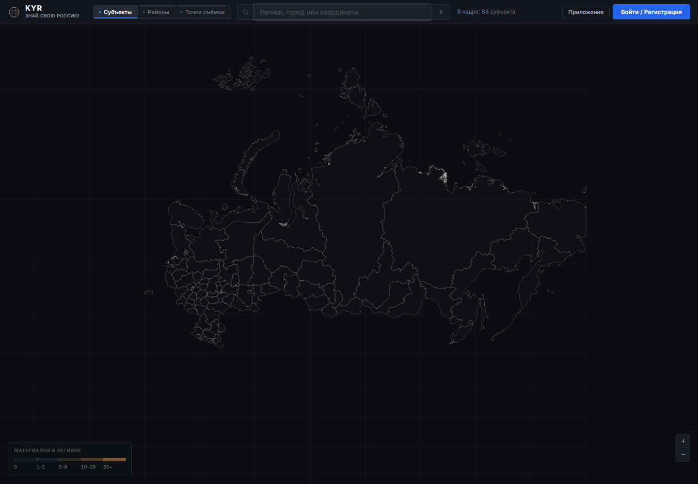

# KYR — Знай свою Россию

Карта фотографий и видео с привязкой к месту съёмки. Пользователи добавляют материалы, администратор проверяет их перед публикацией, а карта показывает одобренные точки и статистику по регионам.



Локально запущенное приложение с отдельной пустой базой. Контуры загружены из поставляемых GeoJSON; пользовательских публикаций ещё нет.

## Возможности

- Просмотр субъектов, районов и отдельных точек съёмки.
- Загрузка фото и видео с координатами, описанием и определением территории по геометрии.
- Регистрация, профиль и аватар пользователя.
- Премодерация: одобрение или отклонение материала с причиной.
- Подсветка территории по количеству одобренных материалов.
- Установка как PWA; отдельный Android-клиент на WebView.

На обзорном масштабе отображаются векторные границы и координатная сетка. При приближении подключается слой OpenStreetMap. Состав территорий определяется файлами в `public/geo/`.

## Локальный запуск

Нужен Bun 1.0 или новее. Внешних npm-пакетов у сервера нет.

```sh
git clone https://github.com/domovoyproj/know-your-russia.git
cd know-your-russia
cp .env.example .env
# Измените JWT_SECRET и ADMIN_PASS в .env перед запуском.
bun run server.js
```

На Windows файл конфигурации можно скопировать командой `Copy-Item .env.example .env`. Откройте `http://localhost:3000`.

Первый запуск создаёт `data/kyr.sqlite`, каталог `uploads/` и начальную учётную запись администратора. Значения по умолчанию в `.env.example` подходят только для локального знакомства; для развёртывания задайте собственный секрет и пароль до создания базы.

## Настройки

| Переменная | Назначение |
|---|---|
| `PORT` | Порт сервера; по умолчанию 3000 |
| `JWT_SECRET` | Секрет подписи токенов авторизации |
| `ADMIN_USER`, `ADMIN_PASS` | Данные начального администратора при создании базы |
| `MAX_UPLOAD_BYTES` | Ограничение загрузки; по умолчанию 512 МБ |

FFmpeg нужен для генерации превью и постеров. Если он не найден, приложение выдаёт оригинальные файлы; запуск карты от него не зависит.

## Данные и доступ

SQLite и загруженные файлы находятся на диске сервера. Для резервной копии сохраняйте и базу `data/`, и каталог `uploads/`: одной базы недостаточно для восстановления медиа.

Публикации становятся видны на карте после одобрения. Кэш PWA помогает повторно открыть интерфейс и сохранённые ресурсы, но не заменяет работающий сервер для регистрации, загрузки и модерации.

## Устройство проекта

- `server.js` — HTTP-сервер, API и раздача файлов.
- `lib/db.js` — схема SQLite и создание начального пользователя.
- `lib/auth.js` — хэширование паролей и токены HS256.
- `lib/geo.js` — работа с геометрией территорий.
- `lib/media.js` — хранение медиа и создание превью.
- `public/` — интерфейс Leaflet, стили, Service Worker и геоданные.
- `android/`, `scripts/build-apk.sh` — Android WebView и инструменты сборки APK.

Основные API: `/api/register`, `/api/login`, `/api/me`, `/api/points`, `/api/areas`, `/api/media` и `/api/admin/pending`. Загрузка и управление профилем требуют входа; модерация — прав администратора.

Автор: [domovoyproj](https://github.com/domovoyproj). Лицензия: MIT.
